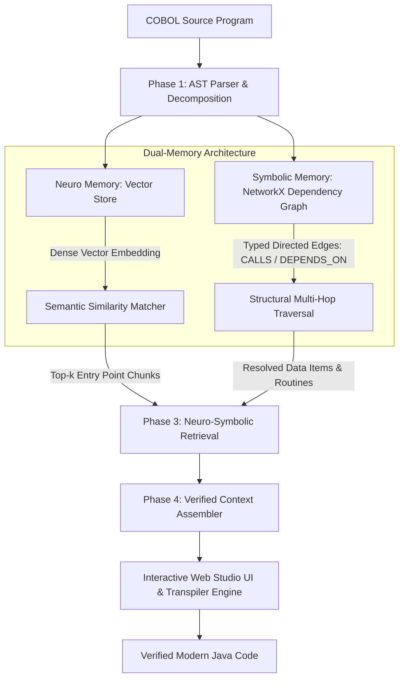

# 🧠 AST-Guided Neuro-Symbolic Migration Studio

[](https://www.python.org/)
[](https://fastapi.tiangolo.com/)
[](https://openjdk.org/)
[](https://en.wikipedia.org/wiki/COBOL)
[](./COPYING)

> **An End-to-End Neuro-Symbolic Retrieval-Augmented Generation (RAG) Workbench & Transpilation Platform for Legacy Enterprise COBOL to Modern Java Migration.**

---

## 📌 Overview

Migrating legacy mission-critical COBOL systems to modern object-oriented languages (like Java) has historically presented a high-risk dilemma:
- **Pure Neural / LLM Approaches** frequently hallucinate variables, lose subtle business edge-cases, break intricate `PERFORM` call graphs, and omit deeply nested `REDEFINES` or `OCCURS` data layouts.
- **Pure Rule-Based / Transpiler Approaches** generate rigid, unidiomatic Java code that lacks modern modularity and architectural clarity.

**AST-Guided Neuro-Symbolic Migration Studio** bridges this divide. It pairs **Symbolic Precision** (deterministic Abstract Syntax Tree decomposition, variable symbol tables, and control-flow graphs) with **Neural Intelligence** (semantic vector embeddings and retrieval-augmented synthesis). The result is transparent, verifiable, and structurally intact software migration.

---

## 🏛️ System Architecture

The core pipeline operates across four coordinated phases:



### 1. Phase 1 — AST-Guided Chunking & Parsing
Instead of crude line-based or token-window chunking, `CobolASTParser` parses the legacy source into syntactically valid semantic units:
- **`IDENTIFICATION DIVISION`** metadata & program specifications.
- **`DATA DIVISION`** records, working-storage hierarchies, level numbers (01–49, 77, 88), data types, and picture clauses.
- **`PROCEDURE DIVISION`** sections and paragraphs with tracked statements (`MOVE`, `COMPUTE`, `PERFORM`, `IF`, `CALL`, `READ`, `WRITE`).

### 2. Phase 2 — Dual-Memory Representation
- **Neuro Memory (Semantic Store)**: Encodes dense multi-dimensional projection embeddings for each chunk to capture conceptual meaning (e.g., "interest rate calculation", "payroll tax withholding").
- **Symbolic Memory (Structural Graph Store)**: A directed multigraph built with NetworkX capturing hard structural relationships:
  - `(Caller) --[CALLS / PERFORMS]--> (Target Paragraph)`
  - `(Procedure) --[DEPENDS_ON / ACCESSES]--> (Data Item)`

### 3. Phase 3 — Neuro-Symbolic Dual-Stage Retrieval
1. **Neural Query Entry**: When a query or migration goal is issued, the vector store performs high-precision cosine search to locate seed entry-point chunks.
2. **Symbolic Multi-Hop Expansion**: The engine crawls the graph outwards from the seed nodes up to $N$ hops, automatically harvesting:
   - Mandatory prerequisite variables and record structures.
   - Downstream paragraphs referenced via `PERFORM ... THRU`.
   - External subroutines and copybook dependencies.

### 4. Phase 4 — Context Assembly & Deterministic Transpilation
The assembled context eliminates hallucination risks by passing exact symbolic schemas alongside the semantic intent. In addition, the platform includes a native, deterministic **COBOL-to-Java Transpiler Engine** (`cobj`) paired with a robust runtime library (`libcobj`) for verified side-by-side transpilation.

---

## ✨ Features & Capabilities

- **Interactive Web Studio**: Real-time browser-based workbench powered by FastAPI and a sleek dark-themed frontend.
- **Dynamic AST Explorer**: Inspect divisions, sections, paragraphs, and individual statements in an interactive collapsible tree view.
- **Dependency & Call Graph Visualizer**: Interactive graphical representation of control flow, performed routines, and shared variables.
- **Dual-Memory Query Console**: Query the codebase semantically and inspect exactly which chunks and structural paths were activated.
- **Built-in Sample Suite**: Preloaded enterprise test programs including `BILLING.cbl`, `PAYROLL.cbl`, and `HELLO.cbl`.
- **Integrated Java Generation**: View generated Java source code and verify compilation status against `libcobj`.

---

## 📁 Repository Structure

```
.
├── web_studio/                     # Neuro-Symbolic Migration Studio
│   ├── backend/                    # FastAPI server & AI engines
│   │   ├── cobol_ast_parser.py     # Hierarchical COBOL AST parser
│   │   ├── neuro_symbolic_rag.py   # Dual-Memory Vector & Graph RAG
│   │   └── server.py               # REST API endpoints & static server
│   ├── frontend/                   # Interactive studio interface
│   │   ├── index.html              # Responsive 3-pane workbench UI
│   │   ├── style.css               # Modern dark theme design system
│   │   └── app.js                  # Dynamic graph rendering & event logic
│   ├── samples/                    # Preloaded COBOL benchmark programs
│   └── generated_java/             # Transpiled Java output targets
│
├── cobj/                           # Core COBOL compiler & code generator (C)
├── libcobj/                        # Standard COBOL runtime library for Java
├── bin/                            # Binary utilities & drivers
├── config/                         # Compiler configuration files
├── copy/                           # Standard copybooks
├── win/                            # Windows Visual Studio solutions
│   └── AST-Guided-Neuro-Symbolic.sln  # Visual Studio Solution
└── tests/                          # Validation test suites (NIST & COBOL85)
```

---

## 🚀 Quick Start Guide

### Option A: Launch the Web Studio (Python / Web UI)

1. **Clone the repository:**
   ```bash
   git clone https://github.com/ksree-2212/AST-Guided-Neuro-Symbolic.git
   cd AST-Guided-Neuro-Symbolic
   ```

2. **Install Python dependencies:**
   ```bash
   pip install fastapi uvicorn networkx numpy
   ```

3. **Start the backend server:**
   ```bash
   python -m web_studio.backend.server
   ```

4. **Access the Studio:**
   Open your browser and navigate to:
   ```
   http://localhost:8000
   ```

---

### Option B: Build the Native Compiler (Linux / macOS)

1. **Install build prerequisites:**
   ```bash
   sudo apt-get update
   sudo apt-get install -y default-jdk build-essential bison flex gettext texinfo libgmp-dev autoconf
   ```

2. **Configure and compile:**
   ```bash
   ./configure
   make
   sudo make install
   ```

3. **Build the Java runtime (`libcobj.jar`):**
   ```bash
   cd libcobj
   ./gradlew jar
   ```

---

### Option C: Build on Windows

1. Open `win/AST-Guided-Neuro-Symbolic.sln` in **Visual Studio 2022**.
2. Select **Release / x64** and run **Build Solution** to generate `cobj.exe`.
3. Use the PowerShell automation scripts in `win/` (`make-install.ps1`) to set up local directories.

---

## 🔬 Research & Theoretical Foundation

This architecture is built on principles of Neuro-Symbolic AI applied to legacy code understanding:
- **Symbolic Grounding**: Guarantees variable scoping, data item constraints, and call execution paths adhere to COBOL 85 standards.
- **Neural Semantic Retrieval**: Provides intuitive natural-language querying and synthesis capabilities over monolithic codebases.

---

## 📄 License & Attribution

- **Web Studio & Neuro-Symbolic Engine**: Released under the [GNU General Public License v3.0](./COPYING).
- **Runtime Library (`libcobj`)**: Distributed under the [GNU Lesser General Public License v3.0](./COPYING.LIB).
- **Core Transpiler (`cobj`)**: Inspired by and built upon the foundational work of the open-source COBOL compiler community.
